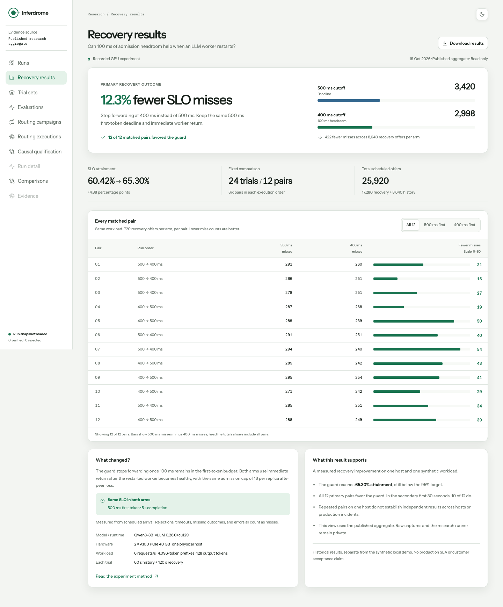

# Inferdrome

**LLM-serving experiments with results you can audit.**

A Python toolkit for controlled traffic, routing and admission experiments,
request traces, queue/KV metrics, and offline evidence verification.

## Measured recovery result

A **100 ms admission-headroom guard reduced recovery SLO misses by 12.34%**
on Qwen3-8B with vLLM 0.26 and two A100 PCIe GPUs.

| Recovery outcome | 500 ms cutoff | 400 ms cutoff |
| --- | ---: | ---: |
| Offers per arm | 8,640 | 8,640 |
| SLO misses | 3,420 | 2,998 |
| SLO attainment | 60.42% | 65.30% |

**24 trials · 25,920 total offers · improvement in all 12 matched pairs.**
Both arms used a 500 ms first-token and 5 s completion deadline; rejects counted
as misses. One host and synthetic workload; attainment remains below the 95% target.

[Method and all pairs](docs/research/RECOVERY_HEADROOM.md) ·
[Aggregate data](docs/results/recovery-headroom-2026-10-19.json)



Open **Recovery results** in the local dashboard to inspect all pairs and download the JSON.

## Earlier studies

**Routing baseline:** 21,300 requests across four policies, all tied at
4 SLO-good requests/s with short prompts and both workers healthy.
[Results](docs/VLLM_ROUTER_RESULTS.md).

Also see the separate [capacity sweep](docs/VLLM_ROUTER_RESULTS.md#separate-capacity-sweep)
and [arrival-pattern pilot](docs/QWEN3_8B_ARRIVAL_PILOT_RESULTS.md).

## Try it locally

Requires Python 3.12 and `uv`.

```bash
uv sync --frozen --extra dev --extra dashboard
uv run python scripts/run_local_demo.py
```

The demo uses synthetic CPU data. GPU results come from separate private captures.
The research studies are separate from the frozen release capability contracts.
Inferdrome produces measurements. ExitSpec owns customer acceptance.
Cloud examples remain dry-run/reference; the local dashboard was
outside the v0.1 release gate.

[Demo](docs/LOCAL_DEMO.md) · [Architecture](docs/ARCHITECTURE.md) ·
[CLI](docs/CLI.md) · [Breakpoint](docs/BREAKPOINT.md) ·
[Engineering notes](README_DETAILS.md) · [Apache-2.0](LICENSE)
